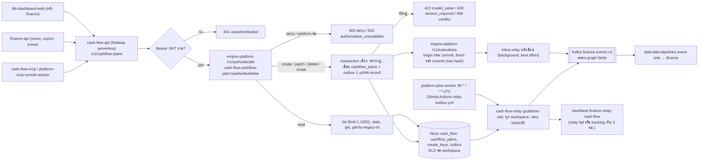

# 01 — Business process (As-Is / To-Be)

finance-cash-flow-api (cell `cash-flow`) เก็บแผนกระแสเงินสดต่อช่วงเวลา: เงินเข้าที่คาด เงินออกที่คาด และเงินสำรองที่ต้องเก็บ ต่อ scope ให้ owner ใช้ผ่าน `life-dashboard-web`, `finance-api` และ MCP; การเคลื่อนไหวจริงอยู่ที่ `finance-transactions-api`

Last reviewed: 2026-11-27 · commit `10cbe95`

## As-Is (จากโค้ดวันนี้)

Sources: `cell.yaml`, `pyproject.toml` (platform-cellkit v1.1.1: `cellkit/app.py`, `cellkit/relay.py`, `cellkit/gateway.py`), `migrations/0001_cash_flow.sql`–`0004_cross_references.sql`, `.github/workflows/relay-outbox.yml`, `.railway/railway.ts`, `README.md`, `PRODUCT.md`

ข้อเท็จจริงสำคัญจากโค้ด:

- โค้ดของ cell มีแค่ `cell.yaml`; route, auth, outbox และ relay มาจาก platform-cellkit v1.1.1 (`src/solo_cash_flow/` ว่าง)
- กฎ: `name` (ไม่เกิน 200 ตัว), `period_start`, `period_end` บังคับ; `expected_inflow`, `expected_outflow` (ค่าเริ่มต้น 0) และ `reserve_target` เป็น `money` ติดลบไม่ได้; `period_end` ต้องไม่ก่อน `period_start` (422 `invalid_value`); `scope` เป็น label อิสระ (ไม่เกิน 64 ตัว); `currency` ISO 4217 ค่าเริ่มต้น THB; PATCH ที่ส่งฟิลด์เงินต้องมี `expected_version` (428, SPEC-009)
- event `cash-flow.cashflow-plan.created/updated/deleted` มีเฉพาะ `scope`, `period_start`, `period_end`, `currency`, `status` (ไม่มียอดเงิน ชื่อ หรือ notes)
- cell นี้ไม่มี `references` / `referenced_by`: ไม่ได้อ่าน Kafka กลับมา ลบได้โดยไม่ต้องตรวจ cell อื่น
- `POST /v1/cashflow-plans/erase` ต้องมี `confirm` = workspace ของผู้เรียก ลบทีละ 1-500 แถว (ค่าเริ่มต้น 200; SPEC-008)
- การตรวจ `X-Gateway-Assertion` (off/report/enforce) และ inline relay ขึ้นกับตัวแปรบน Railway [ต้องยืนยัน: ค่าใน production]

## To-Be (จาก `PRODUCT.md` §Measures และ `specs/004-identity-issuer-trust/spec.md`)

- `specs/004-identity-issuer-trust/spec.md`: cell เชื่อ token ของ platform-identity เคียงข้าง empire-platform; โค้ดอยู่ใน kit แล้ว แต่ "production activation needs a separate owner go"
- `PRODUCT.md` §Measures (Proposed, ยังไม่มีอะไรเก็บ): เดือนปัจจุบันมีแผน active ต่อ scope หรือไม่, ส่วนต่างระหว่าง net flow ที่คาดกับที่เกิดจริงของแผนที่ปิดแล้ว (ต้องใช้ `finance-transactions-api`), 5xx และ p95 latency ของ `/v1/cashflow-plans`
- `PRODUCT.md` §Capabilities: out of scope = inflow/outflow จริง, การพยากรณ์ และการตรวจแผนซ้อนกัน

## Gap

| ID | As-Is → To-Be | Status | Owner | Evidence |
|---|---|---|---|---|
| G1 | รับ token ของ platform-identity ได้ในโค้ด แต่ยังไม่ยืนยันว่าเปิดใน production → owner ตัดสินเปิดใช้ (ตั้ง `CASH_FLOW_JWT_IDENTITY_*`) | decide | owner | `specs/004-identity-issuer-trust/spec.md` (Status) |
| G2 | ไม่มีอะไรเก็บ Measures ที่เสนอไว้ → เก็บและรายงานตาม `PRODUCT.md` | decide | owner | `PRODUCT.md` §Measures ("Proposed (nothing collects them yet)") |

## Open questions

- `PRODUCT.md` §Capabilities ยังเขียนว่า `scope` เป็น enum และ `currency` ยาวได้ 12 ตัว ซึ่งเก่ากว่า SPEC-003 (`cell.yaml` วันนี้: `scope` text ไม่เกิน 64 ตัว, `currency` ISO 4217) ควรแก้ `PRODUCT.md`
- โหมด gateway assertion และ signed events (`CASH_FLOW_EVENT_SIGNATURES`) ใน production เป็นค่าใด
